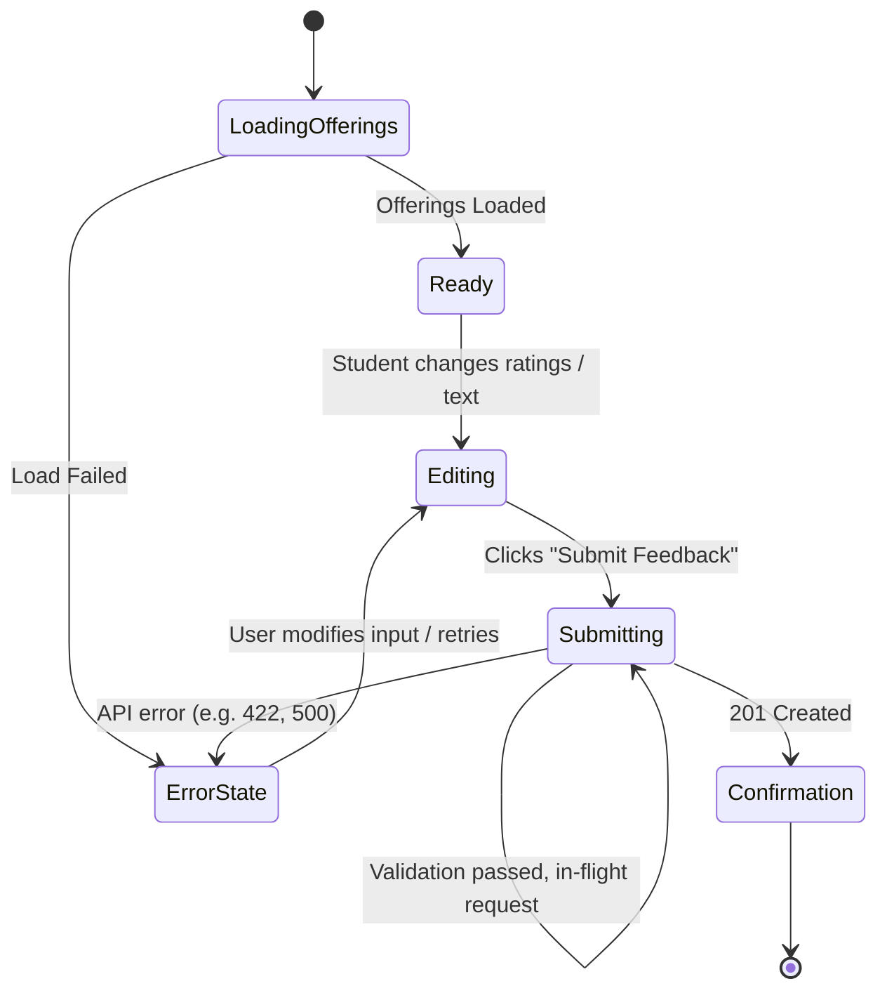

# Stage 5 — Frontend Architecture Specification

---

## 1. Frontend Responsibilities & Boundaries

The React application delivers two distinct experiences: an anonymous, distraction-free **Student Feedback Submission** experience and an information-dense, evidence-oriented **Professor Analytics Dashboard**.

### What the Frontend Owns:
* **Rendering & Presentation**: Displaying clean, academic-grade UI views for students and professors.
* **Form & Interaction State**: Managing transient input state, character limits, selected dimensions, and active filters.
* **Client-Side Pre-Validation**: Immediate boundary checks (1–5 integer checks, text length caps) to minimize network round-trips.
* **Centralized API Communication**: Marshaling JSON payloads, handling authentication tokens, and mapping standardized API errors.
* **UI State Machines**: Explicitly managing `idle`, `loading`, `success`, `error`, and `empty` states for all asynchronous operations.
* **Accessibility & Responsiveness**: Enforcing semantic HTML, focus states, keyboard navigation, and mobile-friendly layouts.

### What the Frontend Does NOT Own:
* **Aggregation & Statistical Calculation**: The frontend never computes averages, percentiles, or dominant sentiment. It consumes pre-computed application-level metrics from the backend.
* **NLP Inference**: No client-side tokenization, sentiment scoring, or keyword parsing.
* **Authoritative Validation**: Client-side validation is purely for user convenience; the server remains the sole authority.
* **Persistence & Credentials**: No direct database access or database credentials. Student submissions use a one-time course token; professors see no identity, while a separate restricted backend eligibility table stores an offering-scoped keyed roster pseudonym.

---

## 2. Application Structure

We propose a **feature-oriented, lightweight modular structure**. Rather than grouping code purely by technical role (e.g., throwing all components in one folder and all hooks in another), code is organized around the domain:

```text
src/
├── app/
│   ├── App.jsx                  # Main application router and root layout
│   ├── routes.jsx               # Route definitions and access guards
│   └── main.jsx                 # Entrypoint mount
├── features/
│   ├── student/
│   │   ├── FeedbackFormPage.jsx # Student submission page
│   │   ├── RatingInput.jsx      # Accessible 1-5 rating component
│   │   ├── CourseSelect.jsx     # Offering dropdown
│   │   └── useStudentFeedback.js# Submission hook & local state
│   ├── professor/
│   │   ├── DashboardPage.jsx    # Professor analytical dashboard
│   │   ├── LoginPage.jsx        # Professor authentication page
│   │   ├── OverviewSection.jsx  # Level 1: Overall metrics & response count
│   │   ├── PerformanceSection.jsx# Level 2: 5 structured dimension ratings
│   │   ├── TopicsSection.jsx    # Level 3: Topic frequencies & sentiment
│   │   ├── EvidenceSection.jsx  # Level 4: Filterable anonymous comments
│   │   └── useDashboard.js      # Dashboard data fetching hook
│   └── auth/
│       ├── AuthContext.jsx      # Minimal token & user state provider
│       └── ProtectedRoute.jsx   # Client-side route guard
├── shared/
│   ├── components/
│   │   ├── Header.jsx           # Clean academic navbar
│   │   ├── LoadingSkeleton.jsx  # Accessible layout loading skeleton
│   │   ├── ErrorNotice.jsx      # Standardized user-facing error message
│   │   └── EmptyState.jsx       # Contextual empty state card
│   ├── api/
│   │   ├── client.js            # Standardized fetch wrapper (base URL, auth headers, error parsing)
│   │   └── endpoints.js         # Endpoint path constants
│   └── styles/
│       └── index.css            # Base academic typography, color palette, and layout tokens
```

*Rationale*: Highly readable and self-contained. A developer working on the student experience only touches `features/student`, while professor dashboard changes are isolated in `features/professor`.

---

## 3. Route Architecture

The application uses standard client-side routing with clean role separation:

| Route | User Role | Auth Required | Purpose | Primary Data Loaded |
| :--- | :--- | :---: | :--- | :--- |
| `/` | Student | Yes (prompted if unauth) | Student feedback portal and course offering submission. | `GET /api/v1/student/me`, `GET /api/v1/student/offerings` |
| `/student` | Student | Yes | Student feedback portal (alias). | `GET /api/v1/student/me`, `GET /api/v1/student/offerings` |
| `/student/login` | Student | No | Student authentication screen (embedded card or dedicated route). | None (`POST /api/v1/auth/student/login`) |
| `/student/feedback/:courseOfferingId` | Student | Yes | Direct course offering feedback evaluation form. | `GET /api/v1/student/offerings` |
| `/login` | Professor | No | Instructor authentication screen. | None (`POST /api/v1/auth/login`) |
| `/dashboard` | Professor | Yes | Assigned offerings selection & dashboard entry. | `GET /api/v1/professor/offerings` |
| `/dashboard/:offeringId` | Professor | Yes | Course offering analytics & evidence explorer. | `GET /api/v1/dashboard/:offeringId`, `GET /api/v1/feedback/:offeringId` |

*Note*: If an authenticated student visits `/?offeringId=3fa8...` or `/student/feedback/:courseOfferingId`, the course dropdown automatically pre-selects that enrolled offering, enabling direct syllabus links.

---

## 4. Page vs. Component Responsibilities

* **Pages** (`FeedbackFormPage`, `DashboardPage`, `LoginPage`):
  - Coordinate URL parameters and data-fetching hooks.
  - Manage high-level layout orchestration.
  - Handle top-level loading skeletons, fatal error boundaries, and empty states.
* **Components** (`RatingInput`, `PerformanceSection`, `EvidenceSection`):
  - Purely presentational or focused on localized interaction.
  - Receive structured data via props; emit changes via callbacks.
  - Do not initiate independent API calls to prevent uncoordinated network requests.

---

## 5. API Layer Architecture

All network traffic flows through a single lightweight module (`shared/api/client.js`).

### Design:
```javascript
// Conceptual API Client Wrapper
async function apiClient(endpoint, options = {}) {
  const token = localStorage.getItem('token');
  const headers = {
    'Content-Type': 'application/json',
    ...(token ? { Authorization: `Bearer ${token}` } : {}),
    ...options.headers,
  };

  const response = await fetch(`/api/v1${endpoint}`, { ...options, headers });
  const data = await response.json();

  if (!response.ok) {
    const error = new Error(data?.error?.message || 'Network request failed');
    error.code = data?.error?.code || 'UNKNOWN_ERROR';
    error.details = data?.error?.details || {};
    error.status = response.status;
    throw error;
  }

  return data;
}
```

### Advantages:
* Enforces centralized error normalization.
* Automatically attaches the professor's Bearer JWT when present.
* Transparently handles `401 Unauthorized` by triggering a logout event in `AuthContext`.
* Zero third-party HTTP dependencies (Axios is unnecessary when native `fetch` handles everything cleanly).

---

## 6. Server State vs. UI State

We enforce a strict separation between server-originated data and client interaction state:

```text
+-------------------------------------------------------------------------------+
| SERVER STATE (Fetched from Backend, Cached in Local Component Hooks)          |
| - Available course offerings                                                  |
| - Aggregate dashboard metrics (Level 1-3)                                     |
| - Anonymous comment list (Level 4 evidence)                                   |
+-------------------------------------------------------------------------------+
                                        |
+-------------------------------------------------------------------------------+
| UI STATE (Component / Local React useState)                                  |
| - Form inputs (selected offering, ratings 1-5, comment text)                  |
| - Submission status ('idle' | 'submitting' | 'submitted' | 'error')           |
| - Dashboard active filters (selected topic filter, sentiment filter)          |
| - Active comment pagination page                                              |
| - Accordion/expansion state for comment evidence                              |
+-------------------------------------------------------------------------------+
```

* **No Redux / Zustand Required**: Because server data is isolated per page and UI state is localized, standard React hooks (`useState`, `useEffect`, `useContext`) are completely sufficient. This eliminates hundreds of lines of boilerplate.

---

## 7. Student Feedback Flow & State Machine



### Submission Safeguards:
1. **Duplicate Prevention**: As soon as the user clicks "Submit", the submit button is disabled and its label switches to *"Submitting..."*.
2. **Network Failure Handling**: If the network fails, the entered text and ratings remain preserved in the form state, accompanied by a clear error message: *"Unable to submit feedback. Please check your connection and try again."*
3. **Double Submission Guard**: After `201 Created`, the form unmounts and renders a calm confirmation that the response was received and is anonymous to professors. The one-time eligibility token is consumed atomically with the submission.

---

## 8. Professor Dashboard Flow & Information Hierarchy

When the professor opens `/dashboard/:offeringId`:

```text
1. Fetch Offering Aggregates (GET /api/v1/dashboard/:offeringId)
   |
   +--> Total Submissions < 5?
   |    YES ---> Render Privacy Notice ("Insufficient submissions to show aggregates")
   |    NO  ---> Render Level 1: Overall Health (Avg Rating, Sentiment Distribution)
   |             Render Level 2: Performance Breakdown (5 dimensions: strong/moderate/weak)
   |             Render Level 3: Topics Overview (Mentions, dominant sentiment)
   |
2. Fetch Initial Evidence (GET /api/v1/feedback/:offeringId?page=1)
   |
   +--> Render Level 4: Representative Comments
   |
3. User Clicks a Topic (e.g., "Practical Examples")
   |
   +--> Update UI filter: topic="practical_examples"
   +--> Trigger GET /api/v1/feedback/:offeringId?topic=practical_examples&page=1
   +--> Smoothly update Level 4 Evidence list
```

---

## 9. Loading, Empty, and Error Architecture

### 9.1 Loading States
* **Dashboard Initial Load**: Renders an accessible layout skeleton matching the metric cards and charts. Avoids jarring full-screen spinners or layout shifting.
* **Evidence Filtering**: Disables the evidence container with a subtle loading overlay and `aria-busy="true"` while preserving existing comments in view until new data arrives.

### 9.2 Empty States
* **No Submissions Yet ($N = 0$)**: *"No feedback has been received for this course offering yet."*
* **Privacy Threshold Not Met ($1 \le N < 5$)**: *"Fewer than 5 responses received. To protect student anonymity, analytics and comments will unlock once 5 or more students have participated."*
* **No Comments Matching Filter**: *"No comments found for the selected topic filter."* Includes a *"Clear filter"* button.
* **No Written Comments**: If all students submitted numerical ratings without text, Level 3 and Level 4 gracefully state: *"All respondents provided numerical ratings without written comments."*

### 9.3 Error States
* **Network / 500 Server Error**: Renders an inline error alert: *"Unable to load course analytics. Please refresh or try again later."* with a manual "Retry" button.
* **401 Unauthorized**: Automatically wipes the expired token and redirects to `/login`.
* **403 Forbidden**: Renders an access denial view: *"You do not have permission to view analytics for this course offering."*

---

## 10. Authentication Architecture

* **Token Storage**: Stored in `localStorage` under `token`, paired with `professor` user profile.
* **Authentication Context (`AuthContext`)**:
  - Provides `{ user, token, login(credentials), logout(), isAuthenticated }`.
  - Initialized on boot by checking token validity.
* **Route Protection (`ProtectedRoute`)**:
  - Renders child routes if `isAuthenticated` is true.
  - Redirects to `/login?redirect=/dashboard` if false.
* **Security Guard**: Client-side routing is strictly for UX. The backend authoritatively enforces all permissions on every API request.

---

## 11. Responsive & Accessibility Architecture

### Responsive Design Strategy:
* **Student Experience (Mobile-First)**:
  - Form inputs and rating scales are sized generously for touch targets ($\ge 44\text{px} \times 44\text{px}$).
  - Single-column vertical layout that adapts smoothly from smartphones to desktop screens.
* **Professor Dashboard (Desktop-Optimized, Tablet/Mobile Adaptable)**:
  - Desktop: 2-column or 3-column grid for overview metrics and topic distributions.
  - Tablet/Mobile: Stacks sequentially following the 4-level hierarchy: Overall $\rightarrow$ Performance $\rightarrow$ Topics $\rightarrow$ Evidence.

### Accessibility Architecture:
* **Semantic HTML**: `<header>`, `<main>`, `<section>`, `<article>`, `<fieldset>`, `<legend>`.
* **Rating Controls**: Implemented as semantic radio button groups (`<input type="radio">`) inside a `<fieldset>` with an accessible `<legend>`, styled customly. This provides out-of-the-box keyboard arrow-key navigation and screen reader support without brittle ARIA hacks.
* **High Contrast**: Compliant with WCAG 2.1 AA standards (minimum 4.5:1 text-to-background contrast ratio).
* **Live Regions**: Form submission errors and loading status announce to assistive tech using `aria-live="polite"`.

---

## 12. Types & Data Contract Strategy

Because the application uses modern JavaScript with JSX, we enforce data contract safety without heavy build-time overhead:
* **JSDoc Type Annotations**: Core entities (`CourseOffering`, `FeedbackSubmission`, `DashboardData`, `TopicSummary`) are documented with strict JSDoc comments in `src/shared/types.js`.
* **Centralized API Mapping**: API response shapes are validated and parsed in `src/shared/api/` before reaching page components, ensuring runtime predictability.

---

## 13. Dependency Recommendations

We enforce a minimal dependency footprint:

| Package | Purpose | Why Native React/Browser is Insufficient | Cost / Overhead |
| :--- | :--- | :--- | :--- |
| **`react` & `react-dom`** | Core library | Mandatory UI runtime. | Standard |
| **`react-router-dom`** | Client-side routing | Provides URL sync, parameters, and route guards. | Negligible (~30 KB) |
| **Vanilla CSS / CSS Modules** | Styling | Native CSS satisfies modern design tokens, Flexbox, and CSS Grid without bloated runtime CSS-in-JS. | Zero bundle cost |

### Rejected Libraries:
* *Redux / Zustand*: Rejected. Server data is localized; global state is unneeded.
* *Axios*: Rejected. Native `fetch` with a 20-line wrapper handles auth, JSON, and errors cleanly.
* *Tailwind / Material UI / Bootstrap*: Rejected. Introduces thousands of utility classes or heavy component bundles. Clean, scoped CSS provides complete academic aesthetic control with near-zero bundle size.
* *Chart.js / D3 / Recharts*: Rejected for MVP. Clean semantic CSS bar charts and progress meters render structured dimensions (1–5) and sentiment percentages cleanly, accessibly, and with zero bundle overhead.

---

## 14. Frontend Architecture Diagram

```text
========================================================================================
                               REACT APPLICATION (App.jsx)
========================================================================================
                                           |
                                [ React Router / routes.jsx ]
                                           |
              +----------------------------+----------------------------+
              |                                                         |
        [ Public / ]                                          [ Protected /dashboard/* ]
              |                                                         |
     (FeedbackFormPage)                                         (DashboardPage)
              |                                                         |
  +-----------+-----------+                     +-----------------------+-----------------------+
  | CourseSelect          |                     | Level 1: OverviewSection                      |
  | RatingInput (1-5 x5)  |                     | Level 2: PerformanceSection                   |
  | CommentTextarea       |                     | Level 3: TopicsSection                        |
  | SubmitButton & Notice |                     | Level 4: EvidenceSection (Paginated Comments) |
  +-----------------------+                     +-----------------------------------------------+
              \                                                         /
               \                                                       /
                v                                                     v
========================================================================================
                           CENTRALIZED API CLIENT (client.js)
========================================================================================
  - Injects Bearer Token from AuthContext
  - Standardizes Error Handling & Codes
  - Validates Response Structure
                                           |
                                   HTTP /fetch over JSON
                                           v
========================================================================================
                            EXPRESS BACKEND (/api/v1/*)
========================================================================================
```

---

## 15. Frontend Decision Table

| Decision | Recommendation | Reason | Alternative Considered | Why Rejected |
| :--- | :--- | :--- | :--- | :--- |
| **Folder Organization** | Feature-based (`features/student`, `features/professor`) | Domain-focused, high cohesion, easy for new engineers to navigate. | Flat technical folders (`/components`, `/pages`). | Scatters related files across disparate folders as project grows. |
| **Routing** | `react-router-dom` | Declarative, battle-tested standard for React SPAs. | Custom history wrapper. | Unnecessary wheel reinvention. |
| **State Management** | Local React state (`useState`, hooks) + minimal `AuthContext` | No cross-page shared state exists; keeps bundle small and logic simple. | Redux Toolkit or Zustand. | Heavy boilerplate; unjustified for an academic application. |
| **HTTP Layer** | Native `fetch` wrapper (`client.js`) | Zero dependencies, built into all modern browsers. | Axios. | Redundant dependency adding bundle weight for standard JSON calls. |
| **Styling Approach** | Clean Semantic CSS / CSS Modules | Direct control over academic aesthetics, accessible variables, zero bundle bloat. | Tailwind or MUI. | Over-engineered styling abstractions and runtime bloat. |
| **Visual Charts** | Semantic HTML/CSS progress meters and bar indicators | Accessible, lightweight, mobile-responsive, zero bundle overhead. | Recharts / Chart.js. | Adds 150KB+ bundle weight for simple 1–5 dimension bars. |
| **Rating Controls** | Semantic `<input type="radio">` inside `<fieldset>` | Accessible out-of-the-box (screen readers, arrow keys, touch targets). | Custom unsemantic `<div>` click listeners. | Breaks accessibility and keyboard navigation. |

---

## 16. Self-Review

1. **Is this more complicated than necessary?**  
   *No*. There is zero global state machinery (no Redux), zero heavy CSS frameworks, and zero external charting engines.
2. **Are responsibilities clearly separated?**  
   *Yes*. The student experience is strictly separated from the professor experience, and API logic is isolated from UI presentation.
3. **Is business logic accidentally moving into React?**  
   *No*. All averages, sentiment percentages, and topic groupings are calculated by the backend. The frontend merely formats and displays them.
4. **Can a new developer understand this in 5 minutes?**  
   *Yes*. The folder structure directly mirrors the two user experiences.
5. **Are error, loading, and empty states robust?**  
   *Yes*. Explicit states exist for $N < 5$ (privacy guard), network errors, empty feedback, and in-flight submissions.

---

## 17. Decisions Requiring Architect Approval

1. **Styling Approach**: Does architecture approve standard vanilla CSS with design tokens and CSS modules, or is an explicit CSS framework preferred? *(Recommendation: Standard CSS Modules for clean isolation and zero bundle bloat).*
2. **Chart Rendering**: Does architecture approve using clean, semantic CSS bars/meters for Level 1–2 metrics, or is an external SVG charting library strictly required? *(Recommendation: Semantic CSS meters match the academic aesthetic perfectly and avoid heavy dependencies).*

---
*(Stopping here as instructed. Awaiting architectural review and approval of the frontend architecture before proceeding to visual/UX specifications or implementation.)*
