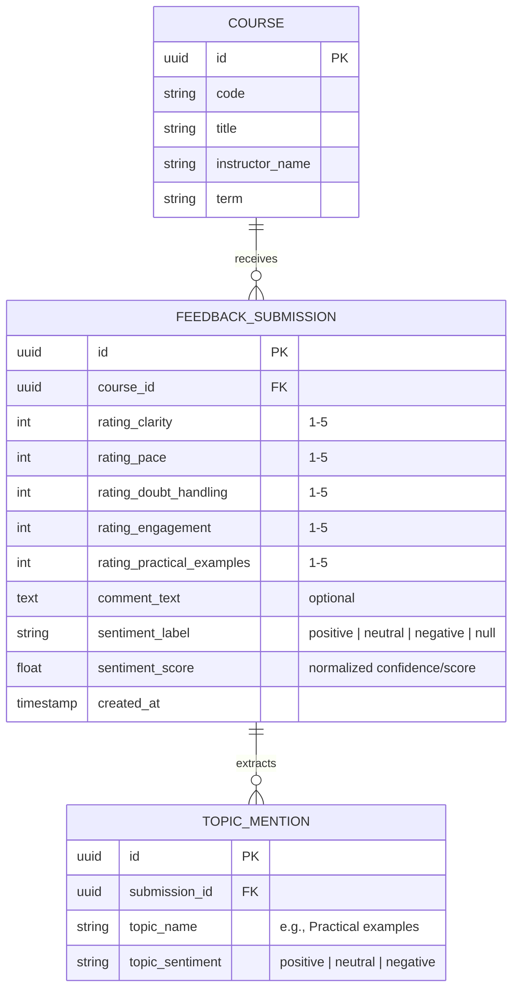

# Stage 1 — Product Specification & Technical Analysis

---

## 1. Contradictions Between Current Project and Specification

* **Greenfield Baseline**: As verified in Stage 0, the repository is completely empty. There are currently no legacy code conflicts, architectural contradictions, or outdated schemas.
* **Scope Discipline**: The product specification clearly scopes the system to a clean pipeline (`Numbers → Patterns → Evidence → Human interpretation`) and explicitly forbids LLM agents, generative AI recommendations, chatbots, and decorative clutter. Because no code exists yet, we have zero technical debt to unwind, allowing us to enforce these exact boundaries from day one.

---

## 2. Ambiguities & Technical Clarifications Required

### 2.1 Anonymity vs. Abuse & Minimum Aggregation Thresholds
* **The Tension**: If student submission is completely unauthenticated and stateless, the API is vulnerable to ballot-stuffing, spam, or malicious automated submissions. Conversely, tracking IP addresses, browser fingerprints, or user tokens can risk student re-identification.
* **Minimum Reporting Threshold**: How should the professor dashboard handle low-sample situations? For example, if a course section has fewer than 5 submissions, displaying individual comments or granular breakdowns might allow a professor to infer which student wrote them. 
  - *Recommendation*: Establish a configurable threshold (e.g., $N \ge 5$) before showing granular comment evidence or demographic/breakdown views; for $N < 5$, show an academic notice such as *"Insufficient feedback submitted yet to display aggregate distributions without compromising anonymity."*

### 2.2 NLP Lifecycle: Synchronous vs. Asynchronous Ingestion
* **Synchronous (Inline)**: Student clicks submit $\rightarrow$ Express sends comment text to Python NLP service $\rightarrow$ Python returns sentiment and topics $\rightarrow$ Express persists both feedback and NLP results in PostgreSQL $\rightarrow$ Response returned to student.
  - *Pros*: Simple, no background worker/queue infrastructure needed for MVP.
  - *Risks*: Python service downtime or latency directly impacts student submission response time.
* **Asynchronous (Background/Job)**: Express saves feedback immediately $\rightarrow$ Feedback status is queued/pending $\rightarrow$ Worker/background task calls Python service and updates the record.
  - *Trade-off*: Higher architectural complexity (queues, job state).
  - *Recommendation for MVP*: For MVP simplicity, synchronous or lightweight non-blocking Express orchestration with graceful fallback (if NLP service is temporarily unavailable, feedback is safely recorded with analysis marked `pending` rather than rejecting the student's submission).

### 2.3 Topic Classification Model & Multi-Label Mapping
* The specification requires that a single comment can belong to multiple topics (e.g., *"The concepts are explained clearly but there aren't enough practical examples"* $\rightarrow$ `Teaching clarity`, `Practical examples`).
* Topic detection can be handled via:
  1. Supervised multi-label classifier (requires labeled dataset).
  2. Rule/keyword/phrase-pattern matching with morphological lemmatization (spaCy / NLTK) — deterministic, zero cold-start training data needed, predictable, highly explainable for university academic settings.
  3. Pre-trained zero-shot classifier (e.g., DeBERTa / HuggingFace NLI pipeline) — flexible, but adds heavy dependencies and runtime overhead.
  - *Recommendation for MVP*: Rule-assisted and lexicon/pattern matching backed by basic NLP tokenization/lemmatization. It requires no opaque training dataset, has zero cold-start delay, runs reliably on standard hardware, and directly aligns with the defined initial candidate topics.

### 2.4 Professor Context & Course Partitioning
* How does a professor access their feedback?
  - Does the prototype require basic professor authentication (e.g., email/password or selecting a professor/course ID from a pre-seeded directory)?
  - *Recommendation*: For MVP, seed 2–3 sample courses (e.g., CS101, CS201) associated with a sample professor profile to keep authentication minimal while accurately demonstrating course-filtered aggregation.

---

## 3. Data Entities & Initial Domain Model

To support the MVP flow, the initial data domain requires three core entities:

*Note: No `student_id`, IP address, or user-agent tracking column is included on `FEEDBACK_SUBMISSION`, upholding strict anonymity.*

---

## 4. MVP Verification Criteria

A successful MVP will be verified against the following end-to-end acceptance tests:

1. **Student Submission Flow**:
   - A student navigates to the form, selects a course, rates 5 dimensions on a 1–5 scale, inputs an optional text comment, and submits.
   - Form validates that all 5 structured ratings are within $[1, 5]$.
   - Submission completes in $< 500\text{ ms}$ and displays a calm confirmation state.
   - If written text is empty, the submission still succeeds without triggering NLP inference.
2. **NLP Ingestion & Accuracy**:
   - Comments with distinct sentiment (e.g., *"Great lectures, very engaging!"* vs. *"Pacing was too fast and doubts were skipped"*) are accurately categorized into `positive`, `neutral`, or `negative`.
   - Multi-topic sentences map to appropriate candidate topics without hallucinating nonexistent labels.
3. **Professor Dashboard Visual Hierarchy**:
   - **Level 1 (Overall)**: Total response count, mean aggregate rating across dimensions, overall sentiment breakdown percentage.
   - **Level 2 (Structured Performance)**: Average score per dimension (Clarity, Pace, Doubt Handling, Engagement, Practical Examples) with visual indicator of relative strengths and weaknesses.
   - **Level 3 (Topics)**: Frequency count and dominant sentiment per topic (e.g., `Practical examples: 12 mentions — Mostly Negative`).
   - **Level 4 (Evidence)**: Filtering/clicking a topic displays actual representative student comments supporting that topic.
4. **Resilience & Privacy**:
   - Anonymity verified: Database inspection confirms zero student identifying fields.
   - Graceful degradation: If the Python service is offline, structured feedback and raw comments still persist safely in PostgreSQL.

---

## Architecture Readiness Summary

**State**: **Ready for architectural planning & contract design**

**Reasoning**:
The product boundaries, domain entities, and dashboard information hierarchy are now strictly delineated. We have established clear guardrails against feature creep (no generative AI, no chatbots, no identifying metadata). We are ready for the architects to approve the technology choices, service contracts, and repository structure for Stage 2.