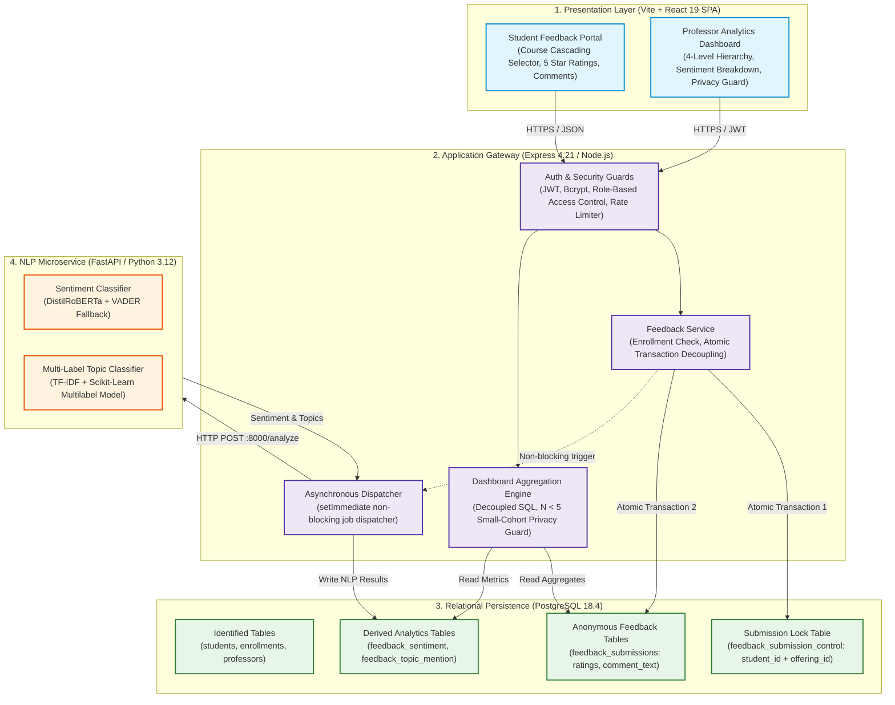
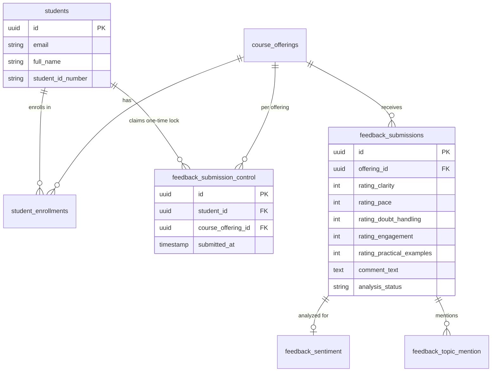
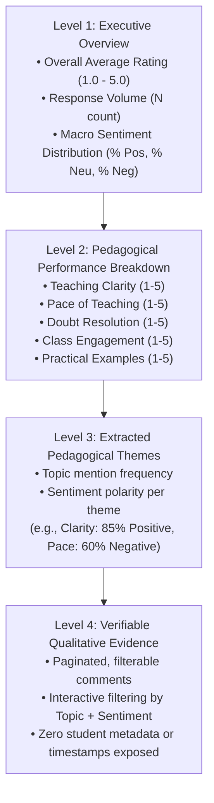
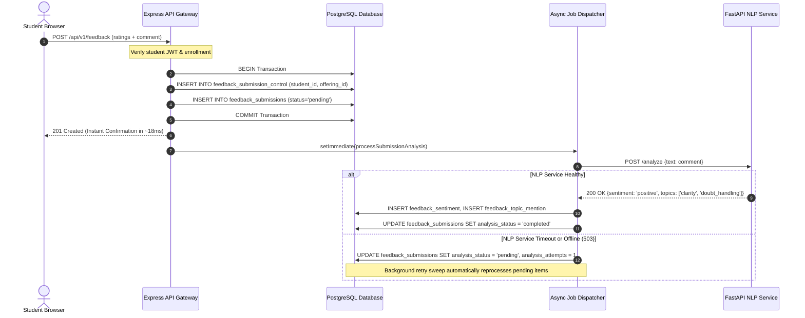

# Student Feedback Analyzer: System Design & Architecture Walkthrough

> **Executive Overview**  
> The **Student Feedback Analyzer** is an end-to-end institutional platform designed to solve a fundamental dilemma in university teaching evaluations: **How do you ensure only verified, enrolled students submit exactly one review per course, while guaranteeing that their ratings and written comments remain strictly anonymous to faculty, department heads, and administrators?**

---

## 1. High-Level Architecture & System Topology

The system is architected as a **3-tier decoupled microservice architecture** backed by a relational database with strict schema-level privacy guarantees:

---

## 2. The Core Innovation: "Level 1 Practical Anonymity"

In naive evaluation systems, student IDs are either stored directly in the feedback row (destroying anonymity) or not checked at all (allowing unverified or duplicate spam submissions).

Our architecture implements **Level 1 Practical Anonymity** through **Cryptographic & Relational Decoupling**:

### Why this design cannot be compromised:
1. **Zero Relational Link**: There is **no foreign key**, no shared primary key, and no reference connecting `feedback_submission_control` and `feedback_submissions`.
2. **One-Submission Enforcement**: The control table enforces `UNIQUE(student_id, course_offering_id)`. If a student attempts to submit again, PostgreSQL aborts with a unique constraint violation (`HTTP 409 ALREADY_SUBMITTED`).
3. **No Foreign Keys to Student**: The `feedback_submissions` table contains only the `offering_id`, the numerical ratings, and the written text. Even a direct SQL database query cannot prove which student authored which feedback.

---

## 3. The 4-Level Pedagogical Analytics Hierarchy

Instead of dumping raw feedback on professors, the dashboard structures information into **4 progressive cognitive levels**:

### The Small-Cohort Privacy Guard ($N < 5$)
If a course has fewer than 5 submissions (e.g., an elective with 3 students):
- **Problem**: In small classes, a professor could easily identify an individual student's writing style or score.
- **Solution**: The backend automatically enforces the **Small-Cohort Privacy Guard**:
  - The aggregate score is hidden.
  - Granular pedagogical dimensions and extracted topics are suppressed.
  - Raw comments are completely redacted.
  - The UI displays an explicit institutional privacy banner:  
    *"Analytics locked until threshold of 5 submissions is reached to protect student privacy."*

---

## 4. Asynchronous NLP Pipeline & Fault-Tolerant Resilience

The natural language processing of feedback comments runs **out-of-band** to ensure that student submissions are never blocked or lost due to ML processing delays:

### Multi-Model NLP Stack:
1. **Sentiment Classification**:
   - Primary: Pre-trained transformer model (`distilroberta-base-sentiment`).
   - Fallback: VADER lexicon-based sentiment analysis when running in lightweight or resource-constrained environments.
2. **Multi-Label Topic Classification**:
   - 7 Institutional Pedagogical Topics:
     * `clarity` (Concept explanation, structure)
     * `pace` (Speed of curriculum delivery)
     * `doubt_handling` (Responsiveness to student questions)
     * `engagement` (Interactive class environment)
     * `practical_examples` (Real-world applications, code samples)
     * `course_materials` (Slides, assignments, notes)
     * `exam_grading` (Fairness and alignment of tests)
   - Evaluated using TF-IDF feature extraction and Scikit-learn multi-label classification.

---

## 5. Security & Defense-in-Depth

The application implements defense mechanisms across every layer:

| Security Vector | Implementation Mechanism | Purpose |
|---|---|---|
| **SQL Injection (SQLi)** | Parameterized queries via `pg` pool + Zod schema typing | Guarantees user input cannot modify SQL syntax. |
| **Cross-Site Scripting (XSS)** | React JSX HTML entity encoding + string sanitization | Comments are stored as plaintext and rendered safely. |
| **IDOR Prevention** | Route-level ownership checks (`verifyOfferingOwnership`) | Professors cannot query analytics or comments for other faculty. |
| **Role Separation** | JWT payload verification (`role: 'student'` vs `'professor'`) | Student tokens are rejected on faculty routes; faculty tokens rejected on student routes. |
| **Brute Force Protection** | Sliding window rate limiting (`authLimiter`) | Restricts authentication attempts to 10 requests per 15-minute window. |
| **Denial of Service (DoS)** | Strict Express body limits (`100kb`) and comment length limits (`2,000 chars`) | Protects database and memory from buffer exhaustion. |
| **Fingerprinting Prevention** | Helmet middleware + `app.disable('x-powered-by')` | Masks server tech stack from automated vulnerability scanners. |

---

## 6. How to Explain the Project During a Presentation or Viva

When asked to explain the system in 2 minutes:

> 1. **The Problem**: Traditional faculty feedback either lacks authenticity because students fear retaliation, or lacks credibility because anyone can post multiple unverified reviews.
> 2. **The Architecture**: We built an Express + React + PostgreSQL + FastAPI system with **Level 1 Practical Anonymity**. We use a dual-table transactional separation: one table locks the student's submission token to prevent duplicate voting, while the feedback itself is written into a completely disconnected table with zero student foreign keys.
> 3. **The Intelligence**: As soon as feedback is saved, a non-blocking asynchronous dispatcher sends the comment to a Python NLP service. DistilRoBERTa and Scikit-learn classify the sentiment and identify up to 7 pedagogical themes (like doubt handling, pacing, and clarity).
> 4. **The Faculty Experience**: Professors get a 4-level dashboard showing overall satisfaction down to specific themes, but with a built-in privacy guard: if fewer than 5 students submit feedback, all individual comments and detailed metrics are masked to prevent reverse-identifying student writing styles.
